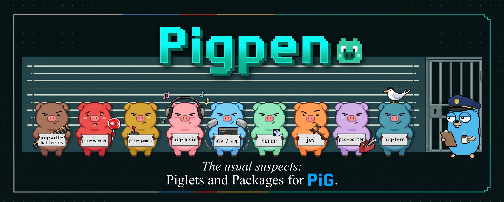

<p align="center"></p>

<h1 align="center">Pigpen</h1>

<p align="center">
Official Piglets and Packages for <a href="https://pi-in-go.dev">PiG</a>, Pi in one Go binary.
<br>
<a href="https://pi-in-go.dev/piglets/catalog/"><b>Browse Piglets</b></a> ·
<a href="https://pi-in-go.dev/packages/"><b>Browse Packages</b></a> ·
<a href="https://pi-in-go.dev/piglets/build/"><b>Build a Piglet</b></a> ·
<a href="https://pi-in-go.dev/docs/latest/piglets">Docs</a>
</p>

---

**Piglet**: a named agent, such as PiG plus a set of tools, prompts and extensions, that you can run by name or build into one signed binary.
**Package**: one extension, skill or tool you install into any PiG.

Everything here is Go on PiG's SDK, so a Piglet fuses into a single executable with no Node.

## Install

These commands are checked against PiG 0.7.0.

```sh
pig piglet pull github:MichaelKinsy/pigpen/pig-with-batteries@0.1.2   # a Piglet, as a signed Binary

pig install npm:@pi-in-go/pigpen-websearch                           # a Package, into your PiG
```

The pull prints where it put the Binary, under `~/.pig/artifacts/piglets/`. Run that file the way you run `pig`. `pig piglet pull` needs the full `github:MichaelKinsy/pigpen/<name>@<version>` form, and the Release column below gives the version for each Piglet.

The full list, with what each one does, is on **[pi-in-go.dev/piglets](https://pi-in-go.dev/piglets/catalog/)**.

## Piglets

| Piglet | Release | What you get |
|---|---|---|
| [pig-with-batteries](piglets/pig-with-batteries) | 0.1.2 | Default PiG with curated extras: herdr state, `/context` `/tools` `/cost`, web search, games |
| [pig-essentials](piglets/pig-essentials) | 0.1.1 | Web search, sub-agents, tasks, structured questions. One binary, no Node |
| [pig-warden](piglets/pig-warden) | 0.1.1 | Guardrails that steer instead of interrupt |
| [pig-porter](piglets/pig-porter) | 0.1.1 | Port a Pi TypeScript extension to Go, with parity proof |
| [pig-tern](piglets/pig-tern) | 0.1.0 | PiG drawn natively in [Tern](https://docs.stencil.so/tern/) |
| [herdr](piglets/herdr) | 0.1.1 | Idle / working / blocked state in [herdr](https://herdr.dev) |
| [acp](piglets/acp) | 0.1.1 | Let Zed and other ACP editors drive PiG, through the `pig-acp` companion |
| [a2a](piglets/a2a) | 0.1.1 | Talk A2A to other agents, and serve PiG tasks to them |
| [pig-games](piglets/pig-games) | 0.1.1 | Two pixel games, `/runner` and `/angry-pigs` |
| [pig-music](piglets/pig-music) | 0.1.1 | A music player, `/music`, because why not 🐷 |

[All Piglets →](https://pi-in-go.dev/piglets/catalog/)

## Port a Pi extension

PiG loads Pi TypeScript extensions as they are, in a Node process. To make one native Go, run **pig-porter**. It checks the SDK for gaps, writes the tests first, proves the port against the original, mutation-tests it, and builds the Package.

```sh
pig piglet pull github:MichaelKinsy/pigpen/pig-porter@0.1.1
```

Run the Binary it prints. Every port is listed in [ports/README.md](ports/README.md), with its upstream, pinned commit, licence and credit. Want one ported? [Open an issue](https://github.com/MichaelKinsy/pigpen/issues/new/choose).

## More

- [CONTRIBUTING.md](CONTRIBUTING.md): changes, checks, the PiG pin and sign-off. Pigpen targets the current PiG release, and every port keeps the original's licence and credits its author.
- [docs/components.md](docs/components.md): what each component does and how it was proven.
- [docs/development.md](docs/development.md): running Pigpen locally, tests and CI.
- [docs/releases.md](docs/releases.md): install forms, what is published, the release process and how the site reads the index.
- [docs/layout.md](docs/layout.md): the repository tree.
- [SECURITY.md](SECURITY.md): private vulnerability reports.

## License

MIT, except ports, which keep their original licence (noted on each Package page and in [ports/README.md](ports/README.md)). See [docs/components.md](docs/components.md#licences-and-credits) for the split.

<!-- licenses:begin (generated by npm run generate; do not edit) -->

Packages whose licence is not plain MIT (read from each `package.json`; every other component is MIT):

| Package | Licence | Use |
|---|---|---|
| [`components/herdr`](components/herdr) | MIT AND Apache-2.0 | permissive; may be bundled |

<!-- licenses:end -->
